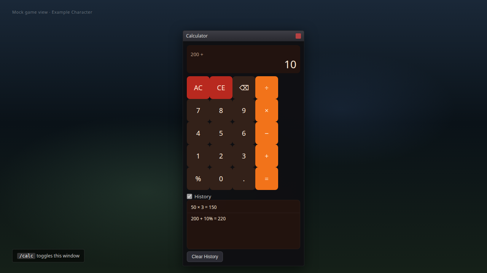
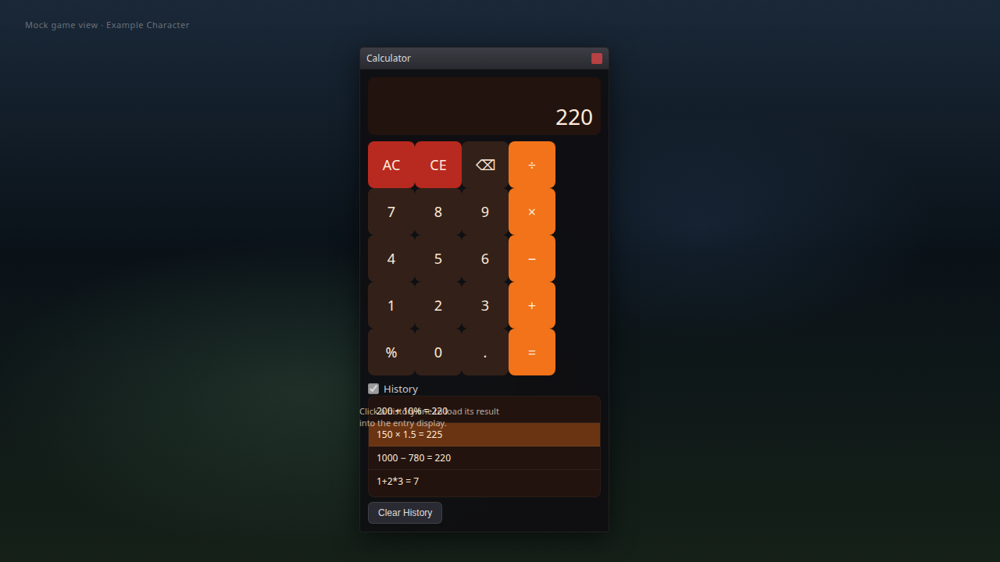
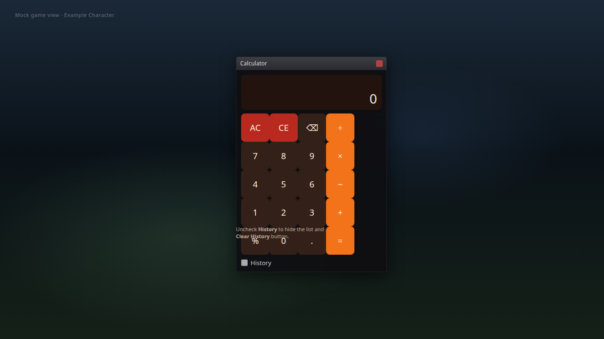
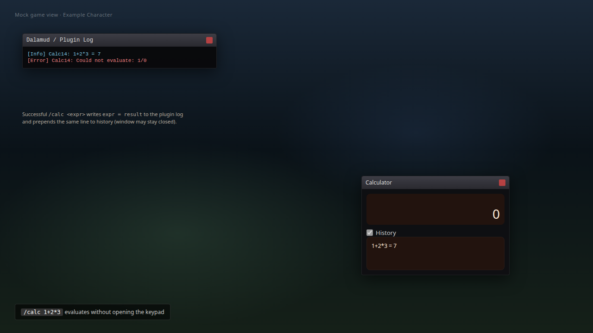
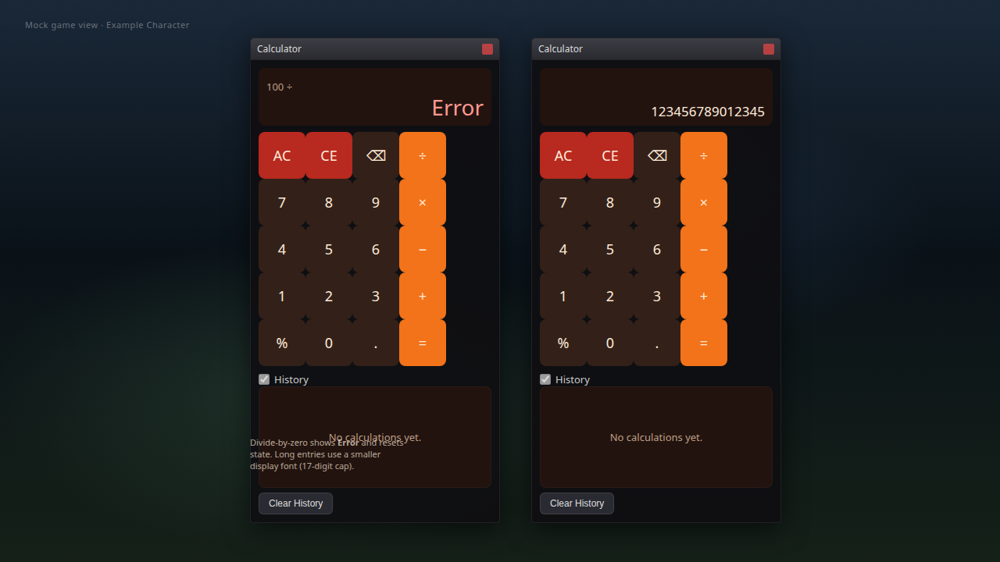
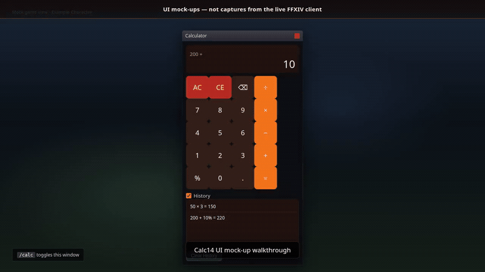

# Calc14


A keypad calculator that opens over FFXIV, with a 100-entry history and inline expression evaluation from chat.

`/calc` · Dalamud API 15 · .NET 10

## Screenshots

Screenshots are mock-ups illustrating the UI, not captures from the live game.

| | |
| --- | --- |
|  | **Main window** — `Calculator` title bar, sub-display (`200 +`), entry display, full 60 px keypad (AC, CE, ⌫, ÷, digits, ×, −, +, `%`, `.`, `=`), **History** checkbox (default on), and **Clear History**. |
|  | **History** — newest-first lines (e.g. `200 + 10% = 220`); click a row to load its result; **Clear History** empties the log. |
|  | **Collapsible history** — uncheck **History** to hide the list and **Clear History** button. |
|  | **Inline `/calc <expr>`** — evaluates without the keypad; success logs `expr = result` via `Log.Info` and prepends the same line to history; invalid input logs `Could not evaluate`. |
|  | **Error & display scaling** — divide-by-zero shows **Error** (empty history shows **No calculations yet.**); long entries shrink the result font (17-digit entry cap). |

### Feature coverage

| Feature | Shown in |
| --- | --- |
| `/calc` toggles the calculator window | [01-main-window-keypad.png](docs/screenshots/01-main-window-keypad.png) |
| Dalamud **Open Main UI** button toggles the same window (no separate settings UI) | Same window as `/calc` — [01](docs/screenshots/01-main-window-keypad.png) |
| Keypad: AC (full reset), CE (clear entry), ⌫, `+` `−` `×` `÷`, `%`, `.`, `=` | [01](docs/screenshots/01-main-window-keypad.png) |
| Sub-display for pending operator; main result display | [01](docs/screenshots/01-main-window-keypad.png), [05](docs/screenshots/05-error-long-display.png) |
| `%` as percent of accumulator after `+` / `−` (e.g. `200 + 10%`) | [01](docs/screenshots/01-main-window-keypad.png), [02](docs/screenshots/02-history-interaction.png) |
| History (up to 100 entries), click line to load result, **Clear History** | [02](docs/screenshots/02-history-interaction.png) |
| **History** checkbox hides/shows history pane | [03-history-collapsed-empty.png](docs/screenshots/03-history-collapsed-empty.png) |
| Empty history message **No calculations yet.** | [05-error-long-display.png](docs/screenshots/05-error-long-display.png) |
| `/calc <expr>` inline evaluation (log + history; shunting-yard precedence) | [04-inline-calc-expression.png](docs/screenshots/04-inline-calc-expression.png) |
| **Error** display (e.g. divide by zero) | [05-error-long-display.png](docs/screenshots/05-error-long-display.png) |
| Long result / entry display font scaling | [05-error-long-display.png](docs/screenshots/05-error-long-display.png) |

### Mock-up video

Walkthrough of the same UI mock-ups (not in-game footage):



[Full walkthrough (MP4)](docs/videos/mockup-walkthrough.mp4)

## What it does

- **Calculator window** — five rows of 60 px keys (AC, CE, backspace, four operators, `%`, `.`, `=`), a right-aligned result that shrinks its font as it grows, and a collapsible history pane; auto-resizing, 320 px wide.
- **History** — the last 100 calculations, newest first. Click a line to load its result; `Clear History` empties the log.
- **Inline math** — `/calc 1+2*3` evaluates without the window and writes to log and history.

## How it works

- Digits append up to 17 characters; a second `.` is ignored and non-digits are dropped.
- `%` divides by 100, except straight after `+`/`−`, where it is that percent of the accumulator (`200 + 10%` → `220`).
- Operators execute immediately, left to right — no keypad precedence. Division by zero shows `Error`, resets, and the next digit starts fresh.
- Results are invariant-culture: `G9` above 1e15 or below 1e-10, else up to 12 decimals; NaN and infinity become `Error`.
- `/calc <expr>` is shunting-yard over `+ - * /` (`x` also multiplies), with precedence and unary minus, no parentheses; errors are logged and add nothing.

## Commands

| Command | Effect |
| --- | --- |
| `/calc` | Toggle the window (also the installer's main UI button) |
| `/calc <expr>` | Evaluate and log an expression; the result is added to history |

## Build

Requires the .NET 10 SDK and the Dalamud dev distribution (`%APPDATA%\XIVLauncher\addon\Hooks\dev`, or `DALAMUD_HOME`).

```
dotnet build -c Debug      # load bin/Debug/Calc14.dll as a dev plugin
dotnet build -c Release    # zip in bin/Release/Calc14/latest.zip
```

Releases are published automatically on each push to `main` that changes the plugin binary; the version is the next four-part number above the latest GitHub release (or the csproj version when it is already higher).

## Install (dev plugin)

1. `/xlsettings` → Experimental → Dev Plugin Locations → add `bin\Debug\Calc14.dll`.
2. `/xlplugins` → Dev Tools → enable **Calc14**.
3. `/calc` opens the window; there is no settings window.

## Tests

`CalculatorState` is a plain class, so the xUnit project runs offline without Dalamud: shunting-yard precedence and unary minus, rejected expressions, percent of the accumulator, the divide-by-zero reset, invariant formatting round-tripping through `TrySetEntry`, and operator chaining.

```
dotnet test Calc14.Tests/Calc14.Tests.csproj    # 18 cases
```

## Limits

- `%` is accumulator-relative only after `+`/`−`; after `×`/`÷` it is a plain entry/100 operand.
- `/calc <expr>` has no parentheses, exponents or functions, and prints to the log — never to the keypad display.
- Not verified in game: behaviour is taken from the code and the offline tests, not from a live client.

## Layout

```
Calc14Plugin.cs     plugin entry point, `/calc` handler and window wiring
CalculatorWindow.cs        ImGui keypad, display, history list
CalculatorState.cs         entry/pending-op state, formatting, shunting-yard evaluator
Calc14.Tests/       xUnit tests for `CalculatorState`
```
