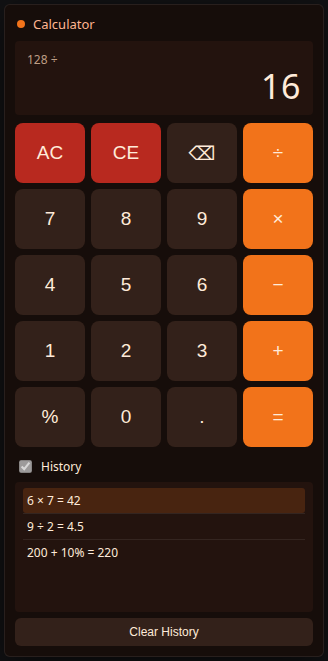
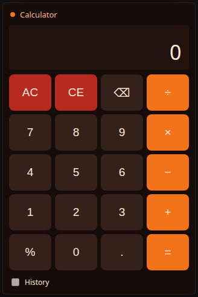
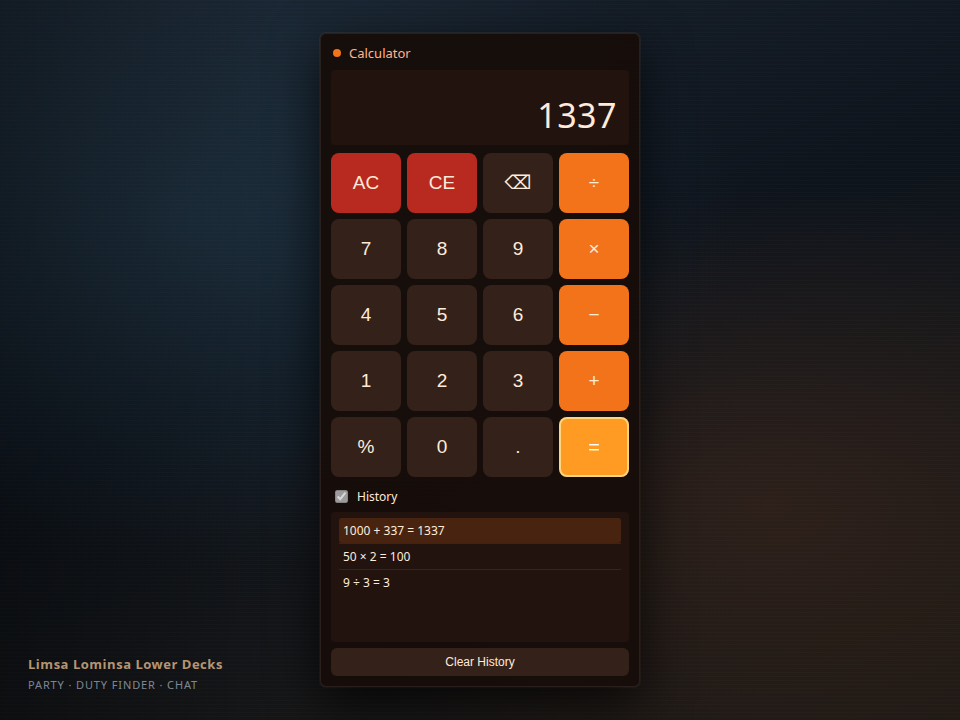
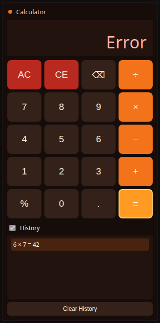

# CalculatorXIV

A calculator plugin for FINAL FANTASY XIV, built on Dalamud.

See [IDEA.md](IDEA.md) for the original goal.

## Simulated screenshots

HTML mockups of the ImGui window after the review-findings build (warm ember palette, `Clear History`, divide-by-zero `Error`). Open [`preview.html`](preview.html) for an interactive gallery.

| Result + history | Mid-operation | Compact |
| --- | --- | --- |
|  |  |  |

| In-game overlay | Divide-by-zero Error |
| --- | --- |
|  |  |

## Layout

- `CalculatorXIVPlugin.cs`: plugin entry point.
- `CalculatorWindow.cs`: calculator UI.
- `CalculatorState.cs`: calculator state.
- `CalculatorXIV.Tests/`: unit tests for `CalculatorState`.
- `preview.html`: UI preview (modes via `?mode=result|mid|compact|overlay|error|gallery`).
- `screenshots/`: simulated PNGs rendered from the preview.

## Build

Requires the .NET SDK and a Dalamud development environment. Check `CalculatorXIV.csproj` before building.

## Tests

`CalculatorState` is covered by a standalone xUnit project (no Dalamud required):

```bash
dotnet test CalculatorXIV.Tests/CalculatorXIV.Tests.csproj
```
